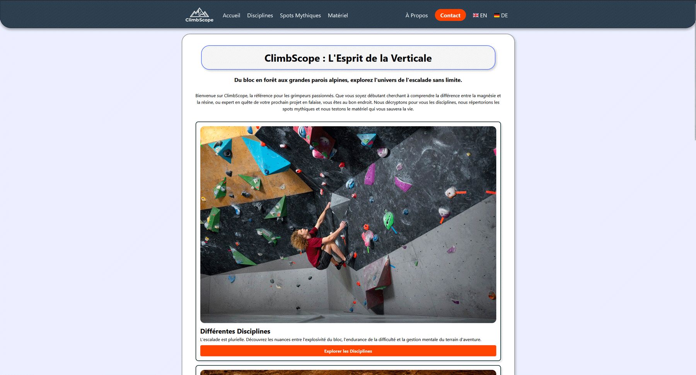

# Climbscope

Site sur l'escalade réalisé pour la **SAÉ 1.05** du B.U.T MMI (IUT de Haguenau), en février 2026.



**Voir le site en ligne : [miletic.alwaysdata.net](http://miletic.alwaysdata.net)**

## Contenu

- **Accueil** et **À propos**
- **Disciplines** : bloc, voie, grande voie, trad, vitesse
- **Spots mythiques** : Fontainebleau, Yosemite, Kalymnos, Siurana, Rocklands
- **Matériel** : chaussons, baudriers, cordes, systèmes d'assurage
- **Contact** : formulaire
- Le site existe en **français, anglais et allemand**

## Technique

- **PHP** : chaque page (`fr/`, `en/`, `de/`) charge ses données et appelle le moteur de templates.
- **Twig 3** : un gabarit commun (`templates/base.twig`) et un gabarit par type de page.
- **Données séparées du code** : le contenu des articles est rangé par langue dans `include/data_fr`, `data_en` et `data_de`.
- **HTML / CSS** : variables CSS pour la palette, une feuille par catégorie.

## Arborescence

```
index.html            redirige vers la page d'accueil en français
sae_105/
├── fr/ en/ de/       une page PHP par rubrique et par langue
├── templates/        gabarits Twig
├── include/          initialisation de Twig et données des articles
├── css/              styles du site
├── images/           illustrations, logos, photos des spots et du matériel
└── composer.json     dépendance Twig
```

## Lancer le projet en local

Il faut PHP 8 et [Composer](https://getcomposer.org).

```bash
cd sae_105
composer install
php -S localhost:8000
```

Puis ouvrir <http://localhost:8000/fr/page1-accueil.php>.

## Auteur

Boris Miletic, étudiant en B.U.T MMI à l'IUT de Haguenau.
[Portfolio](https://miletic-boris.fr/) · [LinkedIn](https://www.linkedin.com/in/boris-miletic-867935315)
